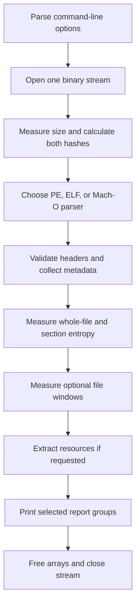

# Reading coffin as a C beginner

Start with a successful report, then follow the same input through the code:

```sh
make
bin/coffin --sections hello-pe64.exe
make test
```

The inspector reads executable bytes as data. It does not execute the file being
inspected. The tests separately run selected known-source Hello World fixtures
when the host or an installed emulator supports them.

## Suggested reading order

| Read | What to look for |
| --- | --- |
| [src/main.c](../src/main.c) | Argument parsing, opening the input, format dispatch, and cleanup |
| [include/common.h](../include/common.h), [src/common.c](../src/common.c) | Shared file state, checked reads, byte decoding, and growing arrays |
| [include/peparser.h](../include/peparser.h), [src/peparser.c](../src/peparser.c) | A concrete header/section parser and its result structure |
| [src/entropy.c](../src/entropy.c) | Counting bytes, floating-point probabilities, streaming, and caching |
| [src/report.c](../src/report.c) | Turning stored results into tables and selecting report groups |
| [src/elfparser.c](../src/elfparser.c) | Two integer widths, two byte orders, and string-table references |
| [src/machparser.c](../src/machparser.c) | Variable-length commands and universal-file slices |
| [src/elf_details.c](../src/elf_details.c), [src/mach_details.c](../src/mach_details.c) | Bounded dependency/symbol tables and sectionless dynamic metadata |
| [src/pe_details.c](../src/pe_details.c) | Address mapping, terminated tables, and resource-tree recursion |
| [src/resource_payload.c](../src/resource_payload.c) | Text conversion, variable records, and bounded previews |
| [src/resource_image.c](../src/resource_image.c), [src/resource_extract.c](../src/resource_extract.c) | Constructing new binary files and managing output handles |
| [src/md5.c](../src/md5.c), [src/sha256.c](../src/sha256.c) | Streaming hash state, bit operations, and block padding |
| [tests](../tests), [Makefile](../Makefile) | Independent checks, generated test inputs, and build rules |

Each C module starts with its purpose. Function comments explain inputs, results,
ownership, and the less obvious rules. Local comments explain algorithms and
binary-format constraints at the point where they matter. You can read the
expanded verbose renderers later; their repeated `printf` calls format fields
that have already been parsed.

## What happens to one input



Some stages return early on error, but allocated resources still need cleanup.
`main` returns `EXIT_SUCCESS` only when all requested work completes. Low-level
helpers usually return `STATUS_SUCCESS` (zero) or `STATUS_ERROR` (-1). Use explicit
comparisons: `if (status == STATUS_SUCCESS)`, rather than assuming a nonzero
value means success.

## The C syntax used most often

### Structures and pointers

A `struct` groups fields; `typedef` gives that type a short name. `InputFile input`
is a structure object, while `InputFile *p` is a pointer to one.

```c
InputFile input = {0};   /* Initialize fields, including pointers, to zero. */
InputFile *p = &input;   /* & takes an object's address. */
input.verbose = 1;      /* . accesses a field on an object. */
p->verbose = 1;         /* -> accesses a field through a pointer. */
```

`const InputFile *p` means a function should not change fields through `p`.
The stream referred to by `p->file` can still move when read: `const` does not
make the underlying file or stream state immutable.

A pointer argument can let a function return an additional value:

```c
size_t size;
if (file_size_checked(file, &size) == STATUS_SUCCESS) {
    /* The function wrote the measured length into size. */
}
```

The array-growth helper goes a step further: it receives the address of an array
pointer, so it can replace that pointer if `realloc` moves the allocation.
The existing calls cast that address to the helper's generic `void **` parameter.
Callers must use the updated array pointer afterward.

### Declarations and the preprocessor

A function declaration in a header describes its name, return type, and
parameters. Its definition in a `.c` file contains the body. Compilation checks
each source file; linking connects calls to definitions in other object files.
A file-level `static` function is private to that source file. A file-level
`static` array has storage for the program's lifetime and is private to the file.
`extern` declares a name whose definition is supplied elsewhere.

`#include` brings in declarations. Include guards prevent a header from declaring
its types twice in one compilation unit. `#define` creates a macro expanded
before C compilation; the hash round macros substitute expressions, while the
report constants substitute bit values. `#if`/`#elif` choose code at compile time,
which is why the Hello World source can contain several OS/CPU implementations.

### Arrays, counts, and allocation

A local array such as `unsigned char buffer[8192]` contains storage directly.
A pointer such as `PESection *sections` refers to storage elsewhere, allocated
with `malloc`, `calloc`, or `realloc`.

- `malloc` allocates uninitialized storage.
- `calloc` allocates zeroed storage.
- `realloc` may move existing storage. On failure, its original allocation still
  exists, so the helper first stores the result in a temporary pointer.
- `free` releases heap storage; it must not receive a pointer to a local array.
  `free(NULL)` is permitted.

A result's **count** is the number of populated entries. Its **capacity** is the
number of allocated slots. Iterate to count, not capacity. The parser result
owns its arrays; a `free_*_info` function releases them. The caller owns the
result object itself, often on the stack. Borrowing a pointer does not transfer
ownership.

`sizeof(array) / sizeof(array[0])` counts elements of an actual array. It does
not count elements behind a pointer. In a function parameter, `buffer[]` is
adjusted to a pointer, so the function also needs an explicit length.

### Byte buffers and strings

C strings end at a zero byte, written `'\0'`. Binary buffers have explicit lengths
and may contain zeros anywhere. Use `memcmp` for fixed-length binary comparisons;
`strcmp` requires terminated strings.

A PE section name occupies eight disk bytes. It may have no terminator, so the
normalized result reserves up to four ASCII display characters per raw byte
plus a terminator. The parser escapes control, backslash, and non-ASCII bytes.
SHA-256's 32 raw digest bytes need 64 hexadecimal characters plus one terminating
zero when displayed. MD5's 16 raw bytes need 33 display-buffer bytes.

### Integer widths and bit operations

`uint16_t`, `uint32_t`, and `uint64_t` have exact unsigned widths. `size_t` is the
unsigned type used for object sizes; it is not necessarily the same width on all
hosts. Unsigned addition wraps when it exceeds the type's maximum. Hash algorithms
use that wraparound deliberately; file offsets and allocation sizes must avoid
accidental wraparound.

Hexadecimal constants start with `0x`. A mask selects particular bits:

```c
flags & mask       /* Keep bits present in both. */
flags | mask       /* Combine bits. */
flags ^ mask       /* Toggle selected bits. */
~mask              /* Flip every bit. */
value << 8         /* Shift toward higher bit positions. */
```

Bitwise `&` and `|` differ from logical `&&` and `||`. Logical operators test
true/false conditions and short-circuit evaluation; bitwise operators manipulate
individual bits. Report selectors combine independent powers of two with `|`.

Cast byte values to an unsigned type of sufficient width **before** shifting.
A high byte promoted to signed `int` and shifted into its sign bit could produce
undefined behavior. A shift count must also be smaller than the operand width.

## Reading a binary format safely

### File layout is not C object layout

A compiler can add padding between struct fields and choose a native byte order.
Consequently the parsers read byte arrays and decode fields at documented disk
offsets, rather than casting file bytes to struct pointers.

Little-endian stores the lowest-value byte first. Big-endian stores it last.
For example, the two little-endian bytes `34 12` represent the number `0x1234`.
The decoding helpers work from bytes, so alignment and the host's byte order do
not change the result.

### Address spaces are different

| Term | Meaning in this project |
| --- | --- |
| File offset | Byte position from the beginning of the input file |
| VA | Virtual address in the image's declared memory layout |
| PE RVA | Address relative to the preferred image base |
| Slice offset | Position relative to one thin Mach-O image |
| Container offset | Position relative to the complete universal Mach-O file |

For a file-backed PE section, mapping uses:

```text
file offset = section raw offset + (RVA - section RVA)
```

The RVA must belong to an unambiguous mapped range. A virtual zero-filled tail
has no bytes to read. Likewise ELF NOBITS and Mach-O zero-fill sections can have
memory sizes without file payloads.

For a universal Mach-O section:

```text
container offset = slice base + section offset
```

Both the range inside the slice and the range inside the complete file matter.
A file-wide check alone could allow one slice to read another slice's bytes.

### Check before adding, multiplying, or reading

`file_range_valid` first checks `offset <= size`, then `length <= size - offset`.
It avoids computing `offset + length`, which could wrap. Table counts are widened
before multiplication, and allocation helpers bound the number of bytes before
allocating them. Every `read_at` requires an exact read; short reads are errors.

Valid byte ranges alone do not bound computation. A resource tree could cycle,
and many sections could repeatedly reference the same bytes. Work/depth limits
and entropy caching prevent these structures from requesting unlimited work.
Limits are described in the main README.

## Cleanup and error handling

`goto` is used for forward jumps to shared cleanup labels. This avoids copying
many `free` and `close` calls into each error branch. A label's position reflects
which resources have been acquired: image construction's `invalid_parts` also
falls through to `invalid_directory`.

Zero-initialized result pointers make cleanup possible after partial parsing.
Cleanup functions clear their pointers after `free`, so a caller can safely clean
up a result whose parser already cleaned up on failure. This does not mean that
arbitrary uninitialized results can be freed safely.

Output uses both integer file descriptors and `FILE *` streams. After successful
`fdopen`, the stream owns closing the descriptor through `fclose`. If `fdopen`
fails, the descriptor must be closed explicitly. A buffered write may fail only
at `fclose`, so extraction checks that result too.

## Understanding the numerical modules

Entropy counts each byte value and evaluates `-sum(p * log2(p))`. A conversion
to `double` is essential before division. One histogram combines all chunks;
averaging chunk entropies would compute a different quantity. `NAN` means there
were no measured bytes, while numeric zero means the bytes were constant.

The hash modules follow `init -> update -> final`. Splitting the same input across
updates must not change its digest. Full 64-byte blocks update a running state;
a partial block stays in the context. Finalization adds padding and the original
message length. MD5 writes little-endian digest words, while SHA-256 writes
big-endian words. Their constants and round schedules are algorithm data, not
values to simplify or change when learning the code.

## Learning from the tests and tools

| Tool/file | Purpose |
| --- | --- |
| [tests/test_hashes.c](../tests/test_hashes.c) | Fixed expected digests, padding boundaries, unaligned input, and update partitioning |
| [tests/test_entropy.c](../tests/test_entropy.c) | Known distributions, cache reuse, work limits, and windows |
| [tests/test_malformed.py](../tests/test_malformed.py) | Run the CLI, inspect reports, and verify rejection/extraction behavior |
| [tests/fixtures.py](../tests/fixtures.py) | Build small binary images with known field locations |
| [tests/fuzz_parser.c](../tests/fuzz_parser.c) | Send generated/mutated byte buffers through real parsing paths |
| [tests/test_differential.py](../tests/test_differential.py) | Compare metadata against independent binary tools |
| [tests/test_distribution.py](../tests/test_distribution.py) | Verify staging, archives, and version output without system writes |
| [tests/run_fuzz.py](../tests/run_fuzz.py) | Preserve fuzz corpus, logs, and reproducible crash inputs |
| [tests/build_samples.py](../tests/build_samples.py) | Optional cross-compilation of known-source executable samples |
| [.github/workflows/ci.yml](../.github/workflows/ci.yml) | Run the build/test workflow on Linux and macOS |

Python's `struct.pack` creates serialized fields; `pack_into` edits a field at an
explicit offset in a mutable `bytearray`. `<`, `>`, `H`, `I`, and `Q` describe byte
order and integer widths. Mutating one field while leaving the rest intact helps
identify which parser rule a test exercises.

A malformed input returning an error is normal during fuzzing. Crashes, hangs,
and sanitizer diagnostics are failures. Deterministic smoke mutations are
repeatable; coverage-guided fuzzing retains inputs that explore new paths.
Neither technique replaces fixed regression cases with known expected results.

The C unit tests use `assert`, so keep `NDEBUG` undefined when running them.
Expected negative entropy tests print work-limit/range errors before reporting
that the test executable passed.

In the Makefile, compilation produces `.o` files and linking joins them into an
executable. Generated `.d` files track header dependencies. The comments explain
`$@`, `$<`, `$^`, pattern rules, library flags, and separate sanitizer outputs.
`oldmakefile` and `git.txt` are historical reference notes, not required setup.

The Hello World source also contains platform-specific inline assembly. Read it
after the portable C modules: register constraints and syscall conventions are
more specialized than ordinary C functions. Its manifest hashes source text as
well as sample bytes, so even a comment-only source edit changes the recorded
source checksum. JSON manifests and executable fixtures cannot contain ordinary
C/Python comments; their explanations belong here and in the sample README.

Release preparation is described in [RELEASING.md](RELEASING.md). The VERSION
file feeds a compiler macro; install/uninstall use a staging prefix, and
`scripts/package_release.py` creates archives without tagging or publishing.
